# Charging controller: refactor design

Status: native-target path implemented in `citifoxcharger/native_charging/`. Legacy recovery remains isolated in the older controller. This document records the design and the remaining migration work.

## Read this first

One manual charging session has **one explicit state**. Events move it between
states. A transition may request a device command. Device responses return as
new events; they do not change session data themselves.

Use a small state machine with Python enums, dataclasses and a transition
function. A separate class for every state is unnecessary here. The objective
is to make the complete charging sequence readable in one place.

This refactor makes decisions predictable and testable. It does not make an
accepted Škoda command proof of charging, or make delayed SOC measurements exact.
New manual sessions use the native-target controller. Existing saved version-1 sessions retain the old controller until their recovery is finished.

## The normal sequence

1. The user selects a target and presses Start.
2. Validate the request before changing devices. Record the session and its target.
3. Select SMARTFOX M+ and wait for confirmed readiness. Phase switching is an
   explicit reason for waiting, with a deadline and a visible countdown.
4. Send one vehicle Start after readiness is confirmed.
5. Wait for measured charging power. An accepted cloud request is not sufficient.
6. Monitor charging and the target using the selected target policy.
7. When stopping, request SMARTFOX Off first, then vehicle Stop. Confirm the
   outcomes and perform any required setting restoration before releasing A+.

The existing native-limit path adds a preparation step only when its capability
and exact readback are established. It must not silently become a prerequisite
for every vehicle. Missing native support is visible before any device change.

## States

| State | Meaning | What the user sees |
|---|---|---|
| `IDLE` | No manual session is running. Retain the previous result separately. | Normal operation; Start is available when its checks pass. |
| `PREPARING` | Establishing the selected target strategy and SMARTFOX readiness. No vehicle Start sent yet. | Preparing, or phase switching with remaining wait time. |
| `STARTING` | A vehicle Start has been submitted; charging power is not yet proven. | Waiting for charging to begin. |
| `CHARGING` | Fresh measurements prove power delivery at the charging point. | Charging, power, SOC age and estimated remaining time. |
| `STOPPING` | Completing a stop and any required cleanup. | Stopping; show which confirmation is missing. |
| `RECOVERING` | Reconciling a saved session with current device observations after restart. | Checking the previous session. No automatic Start replay. |
| `ATTENTION` | The requested result cannot currently be established. | A specific reason and the permitted recovery actions. |

`ATTENTION` does not mean that charging has stopped. Its view must say whether
local power is present, absent or unknown. The same applies to recovery.

```mermaid
stateDiagram-v2
    [*] --> RECOVERING: Backend starts
    RECOVERING --> IDLE: No unresolved session
    RECOVERING --> CHARGING: Saved active session and charging proven
    RECOVERING --> STOPPING: Saved stop intent
    RECOVERING --> ATTENTION: Outcome unresolved
    IDLE --> PREPARING: Valid Start request
    PREPARING --> STARTING: Preparation confirmed; submit Start
    STARTING --> CHARGING: Charging power proven
    CHARGING --> STOPPING: Target policy requests Stop
    PREPARING --> STOPPING: User Stop or required abort
    STARTING --> STOPPING: User Stop or required abort
    CHARGING --> STOPPING: User Stop or required abort
    STOPPING --> IDLE: Stop and cleanup confirmed; release normal mode
    PREPARING --> ATTENTION: Preparation failed
    STARTING --> ATTENTION: Start failed or deadline elapsed
    CHARGING --> ATTENTION: Charging interrupted or observation lost
    STOPPING --> ATTENTION: Stop or cleanup cannot be confirmed
    ATTENTION --> STOPPING: Request or resume Stop
    ATTENTION --> PREPARING: Explicit retry after reconciliation
    ATTENTION --> IDLE: Explicit release with required checks
```



This diagram shows the lifecycle. The transition table below defines the
important decisions; an arrow is never permission to bypass its checks.

## Transition rules

| Current state / event | Decision and next state | Requested effects |
|---|---|---|
| `IDLE` / Start | Reject invalid or unavailable requests without changing devices; otherwise `PREPARING`. | Persist intent, then begin preparation. |
| `PREPARING` / phase switching | Stay in `PREPARING`; repeated reports do not extend the original deadline. | Read telemetry when due. No vehicle Start yet. |
| `PREPARING` / preparation confirmed | Enter `STARTING`. | Persist Start intent, then submit one Start. |
| `STARTING` / accepted Start response | Stay in `STARTING`. | Schedule observations within the shared request budget. |
| `STARTING` / request outcome unknown | Stay in `STARTING` until the observation deadline. | Observe; do not replay Start. |
| `STARTING` / charging power proven | Enter `CHARGING`. | Record charging confirmation and continue monitoring. |
| `STARTING` / rejected request or deadline | Enter `ATTENTION` with the actual reason. | No automatic repeated Starts. Required cleanup is explicit. |
| `CHARGING` / fresh SOC or power | Evaluate the target policy. Stay, stop or require attention. | Only the effects returned by that decision. |
| `CHARGING` / sustained loss of power | Enter `ATTENTION` after the policy's grace period. | Explain interruption; do not report target reached without evidence. |
| Any active state / user Stop | Enter `STOPPING`; invalidate unsent preparation/Start work. | Persist Stop intent, request local Off, then vehicle Stop. |
| `STOPPING` / confirmations | Stay until stop and cleanup requirements pass; then `IDLE`. | Restore a changed setting if required; release A+ only when permitted. |
| Any state / backend restart | Enter `RECOVERING`. | Read saved intent and current telemetry; never blindly replay Start. |
| `ATTENTION` / retry or release | Recheck eligibility for that specific action. | Cancel superseded work before issuing new effects. |

All unlisted events leave the state unchanged and produce no device write.
Changing the target is a separate event: in `IDLE` it edits the next target;
in an active session it updates that session through the target policy. Lowering
an app-monitored target below a valid observed SOC requests Stop immediately.
A native target change remains pending until its exact value is confirmed.
The UI must distinguish requested and effective targets during that operation.

## Code structure

Proposed directory: `citifoxcharger/charging/`. Replace the old `charging.py`
when integration is ready; do not keep both under the same import name.

| File | Responsibility |
|---|---|
| `model.py` | State, events, session data and command outcome types. |
| `machine.py` | `transition(session, event, facts, now) -> Decision`. No I/O, sleeps or implicit clock reads. |
| `policy.py` | Start eligibility, target decisions, freshness limits, readiness and power evidence. Named rules with units. |
| `controller.py` | Serialize events, persist decisions, dispatch effects and feed results back into the machine. |
| `view.py` | Derive messages, allowed actions and progress from the session and observations. |

Keep `skoda.py`, `smartfox_web.py` and `modbus.py` as device adapters. They report
facts and command outcomes; they do not decide session transitions. Modbus
remains read-only. The shared request scheduler owns cloud quota and poll times;
it cannot independently set SMARTFOX Off or change the charging state.

The browser renders the server's view and sends user actions. It must not
implement a second set of Start eligibility or target-control rules.

## Data and command handling

Store a versioned, typed session with these separate concepts:

- **Intent:** session ID, requested target and target strategy.
- **Lifecycle:** one state, entry time, deadline and a structured reason code.
- **Operation:** the current preparation or cleanup step and command outcome
  (`not_sent`, `accepted`, `rejected`, `unknown`, `confirmed`).
- **Evidence:** timestamped SOC, local power/readiness and setting readbacks.
- **Result:** target reached, user stopped, interrupted or failed, with evidence.

Do not persist booleans that can be derived from these fields, such as
`phase_start_pending`, `stop_requested` or `awaiting_fresh_soc`. Requested mode,
observed mode and the right to release normal operation are distinct facts.

One serialized controller owns device writes. Persist command intent before
sending it and associate effects with the session and operation ID. Stop
invalidates queued Starts. A late result from an older operation cannot launch
more work or overwrite the current session. An already transmitted command
cannot be recalled: reconcile its outcome using current observations.

This provides controlled retries, not a claim of exactly-once network delivery.
Unknown outcomes require observation. Never repeat a Start merely because a
browser retries, a request times out, or the backend restarts.

Normal A+ is an explicit transition effect, not a recurring background write.
An Off hold has an explicit owner and reason. While it remains necessary, its
reconciliation is bounded and visible. Releasing it invalidates pending Off work;
the next timer tick must not silently reassert an obsolete stop.

## Target accuracy: policy, not state-machine magic

Keep these strategies explicit:

| Strategy | Evidence required | Limit |
|---|---|---|
| App-monitored SOC | Timestamped vehicle SOC plus local charging evidence. | Delayed SOC can cause overshoot. An HTTP read does not refresh the vehicle's capture time. |
| Vehicle-controlled limit | Supported write and exact, newer readback; restoration plan. | Advertised support or HTTP 202 alone is insufficient. Current Citigo reports have not confirmed this capability. |

Power integration may supply a labelled estimate. It must not masquerade as
measured SOC or automatically replace the stop policy in a structural refactor.
Charging profiles and normal 80% schedules must not be edited speculatively.

Initially preserve and name the existing timing and quota rules. The initial
five-minute fresh-SOC deadline, later freshness bound, request reserve and
protective stop behavior need separate review: these rules caused premature
stops in reported sessions. Moving them into a state machine does not solve
that problem. Change each policy deliberately with a regression scenario.

Use monotonic time for waits within a running process. Persist UTC times for
restart reconciliation and diagnostics; reject implausible timestamps rather
than extending waits indefinitely after a clock change.

## Diagnostics a developer can follow

Record each transition as a small, sanitized entry:

`time | session | previous state | event | next state | reason | effect`

Include requested/effective target, SOC capture age, local power, phase-switch
status, command outcome and quota when relevant. Exclude credentials, VIN and
raw upstream bodies. Apply a retention limit.

Example:

```text
10:00:00 | … | IDLE      | StartRequested   | PREPARING | manual_start       | SelectMPlus
10:00:02 | … | PREPARING | PhaseSwitching   | PREPARING | waiting_for_phases | —
10:01:30 | … | PREPARING | PreparationReady | STARTING  | charger_ready      | StartVehicle
10:01:31 | … | STARTING  | StartAccepted    | STARTING  | awaiting_power     | —
10:01:40 | … | STARTING  | PowerConfirmed   | CHARGING  | measured_power     | —
```

Settings → Diagnostics should answer: **What is the state? Why are we waiting?
Which command was actually sent? What evidence is missing? What happens next?**

## Replacement and acceptance

1. Capture the reported incidents as deterministic tests with fake time and
   simulated adapters. Keep current behavior separate from intended behavior.
2. Build the pure machine and policy tests before connecting hardware effects.
3. Integrate one controller behind the current HTTP interface. Remove the old
   lifecycle and UI decision branches; do not add an enum on top of them.
4. Migrate saved sessions explicitly. Completed sessions remain history;
   unresolved starts/stops/settings enter `RECOVERING`. Invalid state requires
   attention and must never trigger an automatic Start or blind A+ release.
5. Validate in simulation, then perform supervised hardware trials. Offline
   tests prove decisions, not vehicle acceptance or target accuracy.

Required scenarios:

- Phase switching followed by one Start after readiness, including repeated
  phase reports, timeout, Stop during preparation and restart during the wait.
- Start accepted but 0 kW; no false “charging” status and no automatic Start loop.
- Successful first charge followed by a second request, e.g. 85% then 87%.
- Old SOC accepted automatically with age visible; unchanged vehicle timestamps,
  quota exhaustion and missing data produce an explicit reason and result.
- Target reached, target changed during charging, and delayed SOC overshoot.
- Local Stop when Škoda is unreachable; unknown cloud Stop and later confirmation.
- Explicit A+ recovery that stays released; no leftover queued Off or Start.
- Restart/sleep recovery, duplicate clicks and multiple browser clients sharing
  one session, one command stream and one cloud request budget.
- Native limit unavailable, rejected, unconfirmed or changed elsewhere; no
  silent rounding, speculative profile edits or lost restoration obligations.

Acceptance: a developer can explain every device write from a recorded event,
transition and policy rule. The UI cannot claim charging or target completion
without the corresponding evidence.

## First implementation: native targets only

`native_charging/machine.py` holds the typed state, session, facts and pure transitions. `controller.py` owns persistence, adapter effects, eligibility and the compatibility view. These two readable files are intentionally used before splitting smaller model/policy/view files. New sessions use schema version 2. Derived legacy-shaped flags exist only in the HTTP view; they are not saved or used to drive the machine.

`Service.start_manual_charging` selects this controller for new sessions, with no SOC fallback. Version-1 sessions and their existing native restoration remain on the legacy path until ended. Unknown/invalid version-2 proof requires attention and cannot trigger Start. The implementation uses UTC epoch deadlines (with an injectable clock); a dedicated monotonic runtime clock remains follow-up work.

Native protection changes the old freshness policy: old SOC and low read quota alone do not stop an exactly verified charge. Power loss has a 45-second grace period; target completion still needs a vehicle report. Exact limit setup and cleanup each have bounded verification. Unsupported/unreadable initial limits block without device writes. This limitation is relevant to the supplied Citigo responses and must be resolved through real capability evidence, not a speculative API payload.
