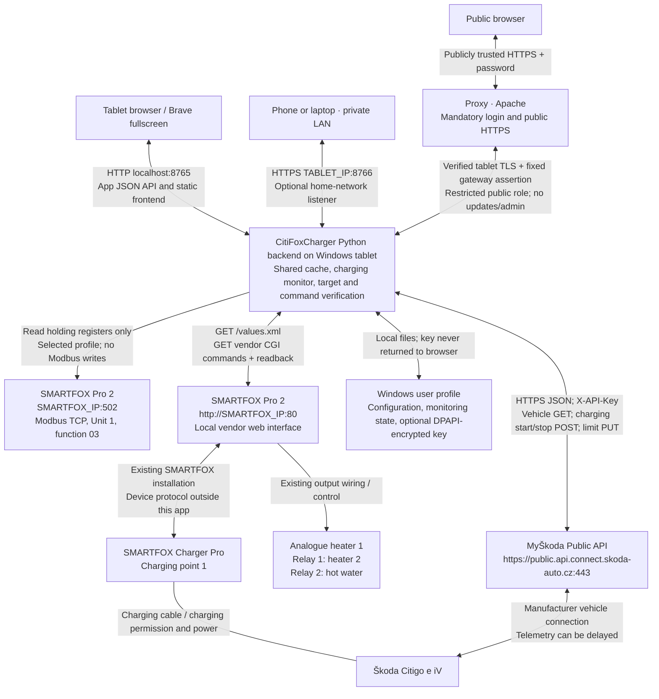

# Communication and data flow

This describes **CitiFoxCharger 1.10.9**, checked against source on **27 October 2026**. Host/address symbols below are generic placeholders, not installation values; the configured device address and active register profile are authoritative. No VIN or API key is included. New manual sessions without readable vehicle limits use the energy controller in [MANUAL-CHARGING.md](MANUAL-CHARGING.md), which also includes its state diagram and uncertainty policy.

## System overview



The diagram separates application connections from the existing charger/output wiring and manufacturer vehicle connection. CitiFoxCharger does **not** obtain SOC through the charging cable or SMARTFOX. It does not implement the protocol between SMARTFOX and its charger, or between the vehicle and the manufacturer's cloud.

**Port 8766 requires `https://`.** Plain `http://` on this port can result in a reset connection. Each remote client needs to trust the tablet's public network certificate. The tablet's local browser instead uses `http://localhost:8765/`. See [NETWORK.md](NETWORK.md) for certificate and firewall setup.

## Unconfirmed native targets

Native target preparation first requires an already readable `charging.settings.targetStateOfChargeInPercent`. Missing readback blocks the attempt before hardware writes. The Citigo's advertised operation alone is not compatibility proof. For an older aborted preparation with no vehicle Start, an explicitly confirmed `POST /api/charging/release-limit-guard` with `accept_unconfirmed_limit: true` may close target control and return to local A+ after fresh Off/zero-power proof. It sends no cloud request and does not assert the limit was restored. A+ may permit scheduled charging. The route has the same session, origin, CSRF and home-network access checks as other control routes.

## Modbus reads

Source: [modbus.py](citifoxcharger/modbus.py). Target: configured SMARTFOX address, default **SMARTFOX_IP**, TCP **502**, Unit ID **1**, function **03 / Read Holding Registers**. The app issues one read per row of the **selected** profile; it does not read both profiles together. Addresses below are the exact, zero-based **PDU addresses passed on the wire**, with no further subtraction. A word is 16 bits.

| Profile | Key | PDU start address | Words | Inclusive range | Interpretation in this app |
|---|---|---:|---:|---|---|
| `observed` (default) | `energy` | 40999 | 4 | 40999–41002 | Requested as total energy; retained as raw words/numeric candidate. Charger semantics unconfirmed. |
| `observed` | `power` | 41015 | 2 | 41015–41016 | Previously requested as charging power; **not** verified as power. Older list describes daily energy. |
| `observed` | `mode` | 42111 | 1 | 42111 | Previously requested as mode; observed 62 is **not** decoded as a mode. Absent from the older list. |
| `manufacturer_v22e` (optional) | `energy` | 41599 | 4 | 41599–41602 | Older list: Charger 1 total energy, Wh. Physical interpretation requires explicit confirmation. |
| `manufacturer_v22e` | `power` | 41605 | 2 | 41605–41606 | Older list: Charger 1 power, W. Physical interpretation requires explicit confirmation. |
| `manufacturer_v22e` | `mode` | 41607 | 1 | 41607 | Raw mode candidate only; mode codes remain unconfirmed for installed firmware. |

Word order is configurable. Only the optional manufacturer profile with `interpretation_confirmed=true` converts its energy/power candidate into a labelled physical value. **There are no Modbus write function codes or register-write calls.** The dashboard's current charging power and named charger mode come from the local web interface below, not from guessing the observed registers.

## SMARTFOX local web reads

Sources: [smartfox_web.py](citifoxcharger/smartfox_web.py), [smartfox_energy.py](citifoxcharger/smartfox_energy.py). All values are obtained in one **`GET http://SMARTFOX_IP/values.xml`** response. XML field names are not Modbus register addresses.

| Display / check | XML fields used | Meaning / handling |
|---|---|---|
| Firmware gate | `version` | Must match `EM3 00.01.16.08`. |
| Charger mode / power | `hidCcMode1`, `cc1Power` | Named charger mode and unit-checked kW. Actual positive power is needed to show energy flow. |
| Charger connection / readiness | `hidCcSt1`, `hidCc1Info`, `hidCcConnTimeout1`, first entry of `hidCcControlCurrent` | Status, permission and offered current. Readiness is not proof of physical charging. |
| Phase switching | `hidCc1Info`, optional `hidCc1TempTime`, `hidCc1Phase` | Info 6 means switching; valid remaining seconds are shown if present. Phase indication 1/3 is not a measurement of the car's actual phase currents. |
| Existing M+ configuration | first entry of `hidCcMplusMode` | Read only; native M+ time/energy limits are not rewritten. |
| Grid / house power | `hidPower`, `hidProduction`, `batteryPower` | Grid W / 1000 = kW; positive grid = import. House kW = production + grid − battery, clamped at zero when all values are valid. |
| Analogue heater 1 | `hidAoutActivated`, `hidAoutMode`, `hidAoutStatus`, `hidAoutPercentage`, `analogOutPower`, `analogOutPercent` | Enablement, mode, status, configured manual percentage, power estimate and actual reported actuation. Manual percentage is not substituted for actual actuation. |
| Temperatures | `analogOutTemp`, `hidAoutTemperatureSensors`, `hidR1TempSensor`, `hidR2TempSensor` | Sensor assignment is retained; 0 means unassigned and 850 °C is a missing-value sentinel. |
| Relays 1 / 2 | `hidRelay1Activated`, `hidRelay2Activated`, `hidR1Mode`, `hidR2Mode`, `hidR1Status`, `hidR2Status`, `hidR1Info`, `hidR2Info` | Enablement, mode, switching state and reason. Relay electrical power is not invented. |
| Output assignment guards | `hidAoutName`, `hidR1Name`, `hidR1Type`, `hidR2Name`, `hidR2Type`; `hidR3Type` for analogue display exception | Controls require the verified installed output assignment; the vendor's type-4 exception affects the analogue percentage display. |

Heater 1 reports **Automatic · surplus** only for automatic status 0 with a positive reported actuation percentage. Status 0 at 0% shows **No surplus**. Manual, scheduled, temperature-control and other states retain their own reason.

## SMARTFOX local web commands

These are **HTTP GET requests with side effects**, matching the installed manufacturer's JavaScript. They are not a publicly specified, general-purpose SMARTFOX API. They require the existing explicit control opt-in and firmware/output checks. Every change is followed by `GET /values.xml` and a matching readback; a successful CGI response alone is insufficient. An already selected mode can return after a read without sending a redundant command.

Base URL: **`http://SMARTFOX_IP`** (configurable private device address).

| Device / action | Method and path |
|---|---|
| Charger 1: Off | `GET /setswcc.cgi?num=0&mode=3&value=100` |
| Charger 1: A+ | `GET /setswcc.cgi?num=0&mode=2&value=100` |
| Charger 1: M+ | `GET /setswcc.cgi?num=0&mode=4&value=100` |
| Analogue heater 1: Off | `GET /setswaout.cgi?mode=0` |
| Analogue heater 1: Automatic | `GET /setswaout.cgi?mode=2` |
| Analogue heater 1: Manual | `GET /setswaout.cgi?mode=1&power={existing_manual_percent}` |
| Heater 2 / hot water: Automatic | `GET /setswrel.cgi?rel={N}&state=0` |
| Heater 2 / hot water: Manual | First `GET /setswrel.cgi?rel={N}&state=3&duration=0`, then `GET /setswrel.cgi?rel={N}&state=1` |
| Heater 2 / hot water: Off | First `GET /setswrel.cgi?rel={N}&state=3&duration=0`, then `GET /setswrel.cgi?rel={N}&state=2` |

`num=0` identifies **charging point 1**; relay `N=1` is **heater 2**, `N=2` is **hot water**. The timer-cancellation call applies only before relay Manual/Off. Analogue Manual reuses the existing valid percentage; a missing percentage blocks that command. No temperature limit, weekly schedule, native M+ timer or arbitrary relay assignment is changed.

## Škoda cloud calls

Source: [skoda.py](citifoxcharger/skoda.py). Fixed origin: **`https://public.api.connect.skoda-auto.cz`**, TCP **443**. Requests use `X-API-Key: <local secret>` and `Accept: application/json`, validated server certificates, no redirects and no environment proxy. The key remains in the backend, optionally encrypted using Windows per-user DPAPI.

| Purpose | Request | Expected response / use |
|---|---|---|
| SOC, vehicle state and permitted operations | `GET /api/v1/vehicles/{vin}?include=charging,operations` | HTTP 200; validates returned VIN. Reads `vehicle.charging.status.battery.stateOfChargeInPercent`, charging/plug state, `vehicle.charging.carCapturedTimestamp` and `vehicle.operations[].name`. Also retains validated, read-only `vehicle.charging.settings` fields and known plug-lock state for diagnostics. |
| Set / restore vehicle limit | `PUT /api/v1/vehicles/{vin}/charging/limit` | JSON body `{"targetStateOfChargeInPercent":90}`; HTTP 202 is only acceptance. A newer post-write vehicle capture must read back the requested setting. |
| Start charging | `POST /api/v1/vehicles/{vin}/charging/start` | Empty body; HTTP 202 means accepted, not confirmed charging. Requires discovered `startCharging` capability and the app's start guards. |
| Stop charging | `POST /api/v1/vehicles/{vin}/charging/stop` | Empty body; HTTP 202 means accepted, not confirmed stopped. Later vehicle telemetry verifies the outcome. |

The public adapter sends the four requests listed above. It does not call charge-mode, charging-profile, wake-up, air-conditioning or duration-estimate endpoints. With a readable/discovered native limit, starts and active target changes use verified native control. Otherwise manual Start uses M+ and Start with app SOC monitoring and no limit PUT; active target changes update the app target. Remaining time is estimated locally. Native support must be established by readback, rather than assumed from advertised operation names. See [INTERFACES.md](INTERFACES.md).

## Browser-to-backend API

The browser never sends the Škoda API key to SMARTFOX or contacts the cloud directly. The backend serves both the local and optional HTTPS frontend from the same shared service.

| Method / path | Purpose |
|---|---|
| `GET /api/session` | Browser session / CSRF bootstrap. |
| `GET /health` | Application identity, instance ID and release metadata. |
| `GET /api/status` | Shared cached telemetry, monitoring and control availability. |
| `POST /api/refresh` | Refresh Car / Auto aktualisieren: request available Škoda data subject to quota/cooldown; does not wake the vehicle or force a newer capture. |
| `POST /api/charging/start` | Select verified-native preparation when readable; otherwise M+ and guarded Start with app target monitoring. |
| `POST /api/charging/stop` | Combined local-first charging stop. |
| `POST /api/charging/target` | Energy-backed sessions update the local target; verified-native sessions use the guarded limit-change flow. It does not repeat Start just because the slider changed. |
| `POST /api/charging/restore-limit` | Explicit retry of an unconfirmed native-limit restoration under guarded Off. |
| `POST /api/smartfox/charger-mode` | Select Off / A+ / M+. |
| `POST /api/smartfox/heater` | Select Off / Automatic / Manual for an authorized heating output. |
| `GET /api/config`, `POST /api/config` | Configuration and key-storage status view / local-only modification. The API-key value is not returned. |
| `POST /api/key`, `POST /api/key/clear` | Local-only API-key setup / removal. |
| `POST /api/skoda/command` | Local-only legacy route. Raw Start is rejected; use the combined charging-start route. |
| `POST /api/smartfox/command` | Legacy local route; Modbus writes remain blocked. |
| `GET /api/diagnostics`, `GET /api/diagnostics/download` | Authenticated local/LAN/public cached diagnostics; allowlisted fields, no device calls. |
| `GET /api/network/certificate` | Local/LAN download of the active profile's validated public CER certificate; no private keys or installation; denied over the public gateway. |
| `POST /api/app/update`, `GET /api/app/update/status` | Local/home-network update job and status, with the existing update guards. |
| `POST /api/app/restart`, `POST /api/app/quit` | Local-only backend process control. |

Mutations require session/CSRF and origin checks. Private-LAN access permits refresh, combined charging start/stop/target, configured output controls, sanitized diagnostics and guarded Git updates. Public-domain requests additionally require the pinned proxy and gateway assertion; public users cannot update, control the backend process, configure devices/keys, download the LAN certificate or invoke experiments. Public and LAN sessions/CSRF tokens are separate. The header reload button only reloads the browser document. See [NETWORK.md](NETWORK.md) for exact gateway setup and permissions.

## Manual start and target stop

```mermaid
sequenceDiagram
    participant UI as Browser
    participant App as Backend monitor
    participant SF as SMARTFOX local web
    participant API as Škoda Public API
    UI->>App: POST /api/charging/start (target)
    App->>App: Validate local telemetry, vehicle access, SOC age and session
    alt Native limit already readable and operation advertised
        App->>SF: Hold Off during native-limit preflight
        App->>API: PUT /charging/limit {targetStateOfChargeInPercent: target}
        API-->>App: 202 Accepted (not confirmation)
        App->>API: GET charging + operations (bounded verification)
        API-->>App: Newer vehicle capture with matching target
        Note over App,API: No fallback after an uncertain native write
    else Native limit absent
        Note over App: Integrate SMARTFOX charge-point kW; correct with new SOC captures; no limit PUT
    end
    App->>SF: Select M+ if needed; read values.xml
    SF-->>App: Mode, readiness, current, phase-switch state
    opt Phase switching is reported
        App-->>UI: Show preparation / countdown; Stop stays available
        App->>SF: Read newer readiness after switching
        SF-->>App: Stable charging permission
    end
    alt Charge-point power already flowing in M+
        Note over App,SF: Adopt existing surplus charging; no redundant Start
    else Settled ready state with zero power
        App->>API: POST /charging/start (full path in table)
        API-->>App: Accepted / unknown / rejected; local power is checked
        Note over App,API: At most three locally checked attempts, spaced >= 180 seconds
    end
    loop Monitoring while backend runs
        App->>SF: GET /values.xml + selected Modbus reads on schedule
        App->>API: Vehicle GET when quota / polling rules permit
        API-->>App: SOC and vehicle capture timestamp
        UI->>App: GET /api/status (cached view)
        App-->>UI: Shared status and estimate
    end
    Note over App: Target reached or user requests Stop
    App->>SF: Select Off; read back mode
    Note over App,SF: Local stop is attempted before cloud access; an unconfirmed Off is an error
    App->>API: Guarded stop processing: read / POST stop as required
    API-->>App: Accepted command / newer vehicle telemetry
    Note over App: Keep Off hold until newer vehicle telemetry confirms stopped
    opt Native limit was used
        App->>API: PUT /charging/limit (previous value or selected 80% fallback)
        API-->>App: 202 Accepted
        App->>API: GET charging + operations
        API-->>App: Newer vehicle capture confirming restored limit
    end
    App->>SF: Return to A+ after required confirmations
    App-->>UI: Stop completed
```

This is the successful combined-control flow, not a promise that every operation succeeds. Start is withheld on failed readiness, authorization, phase-preparation timeout or unavailable capabilities. An uncertain start is only repeated under the new controller's fresh local zero-power/readiness checks, bounded attempt count, spacing and API cooldowns. If local Off is not confirmed, the app exposes that failure. A newer stopped vehicle report can complete the stop without another POST. An explicitly selected charger Off remains Off; A+ restoration above describes the normal combined stop. Native SMARTFOX and vehicle schedules may permit later charging in A+.

## Timing and freshness

- Browser status refresh: every **10 seconds**; this reads the backend cache and does not create one cloud request per browser.
- SMARTFOX configured polling default: **10 seconds**. Command readiness/readback can perform additional local reads.
- Škoda configured polling default: **180 seconds**, adjusted by charging state, quota and cooldown. Idle fallback is at least **600 seconds**; active fallback without usable quota information is at least **180 seconds**. With a known quota window, spare reads are budgeted while retaining three calls for native stop/restoration (two for legacy sessions).
- Manual vehicle refresh has a **60-second** minimum spacing and respects quota/cooldown. Legacy cloud-only monitoring can bring forward bounded near-target/freshness reads; new energy-backed sessions disable these speculative extra probes and retain the normal shared polling schedule.
- Cloud response time and `carCapturedTimestamp` are different. A successful GET can still return old SOC. No force-refresh/wake call is implemented, and a local SOC target can be missed because of delayed/old reports and energy-model uncertainty.
- Monitoring runs in the Python backend, not the browser. Closing the browser or switching the screen off does not itself stop monitoring; actual Windows sleep or backend termination can prevent execution.

Source map: [server.py](citifoxcharger/server.py), [service.py](citifoxcharger/service.py), [charging.py](citifoxcharger/charging.py), [config.py](citifoxcharger/config.py), [app.js](citifoxcharger/web/app.js). For authentication, rate-limit evidence and detailed failure handling, see [INTERFACES.md](INTERFACES.md).

### Legacy request-budget stop (saved cloud-only sessions, not new energy sessions)

Before routine session housekeeping, known inability to read vehicle SOC (two reserved calls left before reset, or a rate-limit cooldown) initiates the same local Off → vehicle stop sequence. The persisted cause is `request_quota`; a new non-charging vehicle report is needed to release guarded Off. A monitored start is blocked with a known budget below four calls. This does not measure SOC through Modbus or bypass Škoda limits.

## Native vehicle target and restoration (1.9.0)

New write: **PUT `/api/v1/vehicles/{vin}/charging/limit`**, `Content-Type: application/json`, body `{"targetStateOfChargeInPercent":90}` (the exact selected integer target; no automatic rounding). The same operation restores the known previous value, or the explicitly selected 80% fallback. No `/charging-profiles/...` or charge-mode writes are introduced. A 202 is never enough: `charging.settings.targetStateOfChargeInPercent` must match in a newer `carCapturedTimestamp` after the write. Preflight is persisted before writes, holds local Off and has at most three reads in 180 seconds. An uncertain PUT is observed without replay; restarting a pending preflight cancels its Start and begins restoration.

After confirmation, the vehicle enforces its limit even when SOC polling is stale or quota is unavailable; legacy quota/data-loss stops apply only to legacy sessions. Routine native monitoring reserves three requests for Stop and limit restoration. A restoration-only GET may use that reserve after local Off is secured. A newer non-charging vehicle report is required before changing back to the previous/normal limit; another matching capture is required before releasing normal A+. Failed restoration holds Off and exposes an authenticated, CSRF-protected retry locally and over HTTPS home-network access.

Diagnostics add a sanitized `vehicle_limit` object with requested/restoration percentages, readback phase, source of the restoration value, write/verification times, probe count and request outcome. Captured SOC remains unchanged. Existing local SMARTFOX M+ time/energy settings remain in effect and can independently stop a charge. A successful live cycle on this Citigo is still unconfirmed; missing native readback blocks Start rather than simulating support.

The app separately records a start confirmed from two fresh charger-specific power samples >=0.5 kW over >=3 seconds. This does not write SOC. If automatic restoration cannot be read back, Settings offers explicit user confirmation of the actual restored limit through `POST /api/charging/confirm-restored-limit`; it requires fresh local Off/zero-power proof and records a user confirmation, never API proof or a new Start.

## Isolated vehicle-limit capability test (1.9.4)

`POST /api/charging/limit-test/set` accepts an exact integer `target_percent` from 1 to 100 and an idempotent `request_id`. The vehicle may reject particular values; they are never rounded. It requires an inactive charging/restoration session, valid vehicle access/advertised limit capability, budget/cooldown permission and a new local read of SMARTFOX Off/zero power. The user Off choice and test intent are saved before exactly one existing `PUT /api/v1/vehicles/{vin}/charging/limit` with, for example, `{"targetStateOfChargeInPercent":37}`. No current-limit readback is required to perform this explicit experiment. This endpoint alone sends no charging command or SMARTFOX write.

API acceptance and verification are separate. Missing limits remain `not_returned`. Only an existing scheduled successful GET with an exact, newer post-write vehicle capture can mark a limit `confirmed`. No polling loop, delayed automatic write, Start or retry is created. Persisted uncertain requests are not replayed.

The explicit 80% button sends one separate PUT under the same local Off requirement. `POST /api/charging/limit-test/end` requires `acknowledge_unconfirmed_limit: true`; it only ends isolation and retains explicit Off. A+ requires a separate user action. Test-active Start and mode-change gates are enforced in the service, not just the UI. Both endpoints use the existing session/CSRF/origin and home-network authentication checks. Cached diagnostic exports include an allowlisted test report.

### Optional supervised Start without limit confirmation (1.9.5)

**1.9.7 update:** new trials persist `runtime_limit_seconds: 3600` before enabling M+, and the one Start sets `runtime_deadline` to Start time +3600 seconds. No target-SOC stop is introduced. All existing device, phase and +2 SOC fallbacks remain. The public/diagnostic trial includes its actual duration and `evaluation` (`pending`, `external_power_drop_observed`, or `inconclusive_app_stop`). Historical records derive their old actual duration without relabelling or extending it. Completed trial evidence is preserved when sending the normal 80% limit for the same VIN. The overview Start uses the same consent-protected trial route when test isolation is armed; ordinary manual Start remains blocked by the existing backend test gate.

`POST /api/charging/limit-test/start-trial` requires exactly `target_percent`, an idempotent `request_id`, and `accept_unconfirmed_limit: true`. It uses the last accepted/uncertain limit attempt (including HTTP 500), for this VIN, at most ten minutes old. The exact target must be 1–5 percentage points above reported SOC. Definitive rejection, active regular charging/restoration, missing request budget/cooldown permission or unverified local Off/zero power blocks the trial. It never sends another limit PUT.

The backend persists `waiting_ready` before setting local M+, waits for verified readiness/phase switching and three-second settling (six-minute maximum), then persists `observing` and an uncertain Start intent **before** one empty-body vehicle Start POST. A retry/new request ID cannot repeat a trial for the same limit attempt. No cloud readback is required. Existing normal reads continue without a new polling loop.

Target SOC itself does **not** trigger an app stop during the trial. Two ≥0.5 kW local samples ≥3 seconds apart establish charging power. A later ≤0.1 kW interval of 30 seconds records an external power drop before local Off and one vehicle Stop. This never proves why the car stopped or that the limit was applied. Distinct app stop causes include manual Stop/Off, 60 minutes from Start, a newer SOC at target +2 points, no power within three minutes, phase/readiness timeout, telemetry loss, mode change and backend restart. Local Off is retried at ten-second intervals when necessary; Start, limit and uncertain Stop are not replayed. Completion requires fresh Off/zero-power readback. No automatic 80% restoration or A+ follows.

The main Stop route `/api/charging/stop` also stops the trial, independently of cloud access. End-isolation, limit changes, normal Starts/mode changes, backend restart/shutdown and updates are blocked until it stops. Unexpected restart cancels a deferred Start and enters `stopping`. The trial state machine is isolated in `limit_trial.py`; persistence shares the private test record. Sanitized diagnostics include HTTP outcomes, physical-power timestamps and the exact stop cause. Session, CSRF, origin and configured HTTPS home-network authentication apply, including passwordless mode.

**Late phase switching (introduced in 1.9.6):** verified local `phase_switching` during observation enters `waiting_resume`, clears pending low-power completion evidence and keeps M+. Its own six-minute bound and the persisted overall trial deadline both apply. After the switching flag clears, new ≥0.5 kW readings at least three seconds apart are required within three minutes. They return to `observing` without another Start POST. Otherwise `phase_resume_failed` records an app fallback. Diagnostics include `phase_started_at`, `phase_ended_at` and `power_resumed_at`. The +2 SOC guard and manual Stop remain active during switching; no deadline or limit is extended. No phase flag means the original zero-power stop detection still applies.

## Current charging display

SMARTFOX charge-point kW appears prominently on the left with one decimal place. The battery displays vehicle SOC or the active energy-based estimate marked `*`; the lightning symbol appears only when charging is recognized. The long bar shows the selected target. The footer retains the actual last vehicle SOC and capture timestamp, and explains `*` separately. Approximate HH:MM remaining time and arrival time use the same existing energy/power assumptions; they are not cloud-provided forecasts. UI polling, Refresh Car and header page reload are separate actions; none is a verified vehicle wake-up operation.
