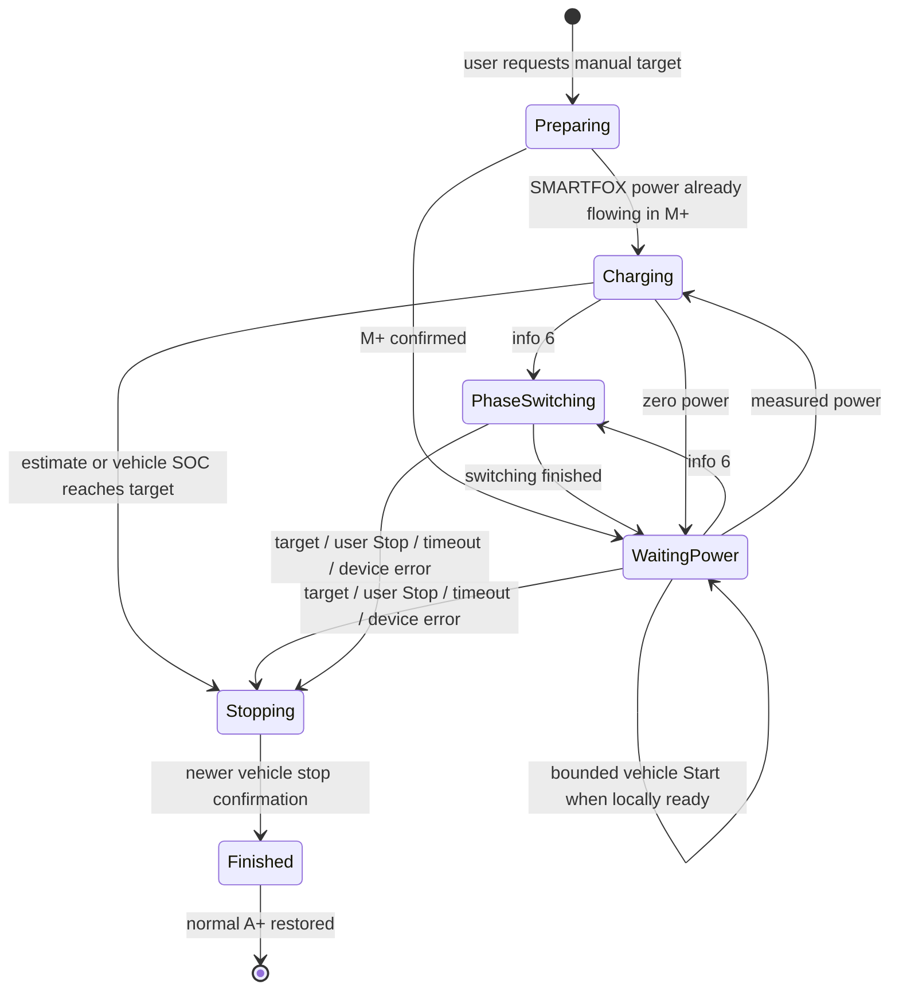

# Manual charging

Current application: **1.10.9**, checked **27 October 2026**. The energy-controller behavior described here was last changed in 1.10.1; subsequent charging-dashboard changes are presentation only.

New sessions for this Citigo use `manual_charging.py`. `charge_energy.py` is a pure energy calculation with no network or device effects. `charging.py` retains persistence, target-report stops, local-first Stop and recovery of existing sessions. Previously saved cloud-only sessions and the isolated vehicle-limit experiment are not silently converted.

## Entry and start

The button accepts a request with fresh local telemetry for a connected vehicle (states 2, 3, 5 or 6), verified local control, usable API credentials/capabilities and a known SOC from the last 24 hours. A target must be above the last reported SOC. Disconnection, authorization/error state, pending Stop, update/restart and isolated experiments still block conflicting commands. A+ surplus charging is a valid entry, including 0 kW during a pause. Start/read request quota alone does not disable an otherwise valid request.

The intent is saved before selecting M+. Existing positive charge-point power is adopted without a redundant vehicle command. Otherwise the backend waits for verified readiness and three seconds of settling. A phase switch may take up to ten minutes; after it ends the car gets fifteen seconds to resume itself. An unflagged pause after power flow gets ninety seconds. Only confirmed zero-power readiness permits a vehicle Start; at most three commands are sent per continuous waiting period, at least three minutes apart, respecting API cooldowns. Two fresh samples at least three seconds apart with at least 0.5 kW replenish that retry allowance for a later interruption; a single spike does not. Total attempt numbers remain monotonic so request IDs are never reused. Accepted/unknown responses do not establish power flow. Initial queued preparation is bounded by 65 minutes, only until power first flows; this initial deadline never ends a later pause. Loss of power after charging is bounded by ten minutes. Failure is reported, not labelled target success.

M+ is held through SMARTFOX schedule changes back to A/A+. Explicit A+ or Off in CitiFox ends the manual controller. External Off, disconnection or charger error cancels the attempt. Selecting A+ deliberately returns control to normal vehicle/SMARTFOX schedules.

## Energy and SOC

`estimated SOC = anchor SOC + measured AC kWh after anchor × 0.90 / 32.3 kWh × 100`

Actual charge-point kW is integrated between distinct fresh timestamps using trapezoids. Zero-power pauses add no energy. Re-reading the same sample adds nothing. The baseline is the last known integer vehicle SOC at manual-start time; its original age is retained. Pre-start energy cannot be recovered without historical measurements. This baseline uncertainty can cause overshoot or undershoot.

A strictly newer vehicle capture within the recorded energy history replaces the anchor SOC. Energy is interpolated at that capture timestamp, so a delayed report does not erase charging that occurred between capture and receipt. Duplicate/older reports never rebase the estimate. History, energy and retry intent persist across backend restart. Screen-off alone does not create a measurement gap if Windows keeps the backend awake.

The user prioritizes continued charging over an unnecessary early stop and accepts up to roughly **five additional percentage points in uncertain conditions**. A SMARTFOX gap over thirty seconds is therefore recorded separately as unmeasured energy, not treated as measured kWh and not an immediate stop. A possible upper SOC assumes up to 7.4 kW (or higher previously observed power) and no losses during the unknown interval. Charging continues until the ordinary measured-energy estimate/vehicle SOC reaches the target, or this possible upper SOC reaches **target +5**. A new vehicle capture reduces the accumulated uncertainty. A storage failure still secures Off, because reliable monitoring cannot be persisted. The +5 bound is a model-based fallback, not a guarantee about actual battery SOC; an old starting SOC and uncertain usable capacity remain limitations.

32.3 kWh usable capacity and 90% efficiency are modelling assumptions, not measurements of this car. Temperature, battery ageing, auxiliary loads, integer rounding and stale baseline SOC affect accuracy. Repeat real tests and compare captured SOC/energy before calibrating these constants. Neither an exact percent stop nor an unconditional start can be guaranteed by a cloud API and an energy estimate.

## Stop and diagnosis

Stop first sets and reads back SMARTFOX Off, then requests vehicle Stop when access permits. Off stays held until newer vehicle evidence confirms stopped; only then is normal A+ restored. A target report uses `target`; the calculated threshold uses `estimated_target`. Measurement, device and startup failures have separate unsuccessful causes. Stale SOC/read quota is not a stop reason for new energy-backed sessions. Existing vehicle charging schedules are unchanged and can charge again after A+ is restored.

Settings → Diagnostics exposes strategy, preparation phase, total/per-wait attempts, waiting time, estimated SOC, accumulated kWh, anchor timestamp, initial report age and stop cause. Starting a new session retains up to ten previous session summaries in the same private state file. JSON exports include these as `previous_sessions`, allowing a failed attempt to be inspected after a retry. Completed stops also record the confirming vehicle SOC and its capture timestamp. The history is sanitized again on export; no credentials, VIN, request IDs or raw energy history are exported. Cloud polling remains budgeted; speculative extra freshness/near-target reads are disabled for energy-backed sessions.

Experimental vehicle-limit controls are hidden during normal use. Existing active tests and native-limit recovery retain only their necessary completion/restoration controls, so hiding experiments cannot strand an old isolation state.

## Dashboard and refresh

The normal action is **Start charging / Laden starten**. Recovery/test actions keep their specific labels when applicable. The target slider remains adjustable during supported active sessions. The main kW reading has one decimal place; the battery shows the displayed SOC, with `*` for an active energy estimate. The long SOC bar carries the selected target marker. On phones, kW and battery share a row; charging animation has its own row only while charging.

**Last vehicle report** always includes the actual reported integer SOC and original capture timestamp, separately from the displayed estimate. Settings diagnostics also retain API retrieval time; a new response can contain the same older vehicle report. **Refresh Car / Auto aktualisieren** invokes the existing budgeted vehicle refresh, with at least 60 seconds spacing and applicable cooldown/reserve checks. It is not a wake command or a guarantee of fresh in-car data. The header's Reload page only reloads the website.

Remaining duration uses the displayed active estimate (or a non-stale vehicle SOC), the existing 32.3 kWh/90% assumptions and fresh measured charging power. It is rounded up to five minutes and shown as HH:MM plus an approximate arrival clock time. No ETA is invented for zero/stale power, phase switching or missing usable SOC. This display forecast does not introduce another stop rule.
