# Manual charging

Current application: **1.11.0**, checked **27 October 2026**. Energy estimation and target-stop thresholds are unchanged; the initial start now prepares phase selection before the vehicle Start and M+.

New sessions for this Citigo use `manual_charging.py`. `charge_energy.py` is a pure energy calculation with no network or device effects. `charging.py` retains persistence, target-report stops, local-first Stop and recovery of existing sessions. Previously saved cloud-only sessions and the isolated vehicle-limit experiment are not silently converted.

```mermaid
stateDiagram-v2
    [*] --> Preparing: user requests manual target
    Preparing --> VehicleStart: phase policy prepared; switch observed if possible
    VehicleStart --> WaitingPower: Start accepted, then M+ confirmed
    WaitingPower --> PhaseSwitching: info 6
    Charging --> PhaseSwitching: info 6
    PhaseSwitching --> WaitingPower: switching finished
    WaitingPower --> Charging: measured power
    Charging --> WaitingPower: zero power
    WaitingPower --> WaitingPower: bounded vehicle Start when locally ready
    Charging --> Stopping: estimate or vehicle SOC reaches target
    WaitingPower --> Stopping: target / user Stop / timeout / device error
    PhaseSwitching --> Stopping: target / user Stop / timeout / device error
    Stopping --> Finished: newer vehicle stop confirmation
    Finished --> [*]: normal A+ restored
```

## Entry and start

The button accepts a request with fresh local telemetry for a connected vehicle (states 2, 3, 5 or 6), verified local control, usable API credentials/capabilities and a known SOC from the last 24 hours. A target must be above the last reported SOC. Disconnection, authorization/error state, pending Stop, update/restart and isolated experiments still block conflicting commands. A+ surplus charging is a valid entry, including 0 kW during a pause. Start/read request quota alone does not disable an otherwise valid request.

New manual requests save the original A/A+ and M/M+ phase policies, then select three phases through the verified vendor web form. An actual reported phase switch is awaited with its manufacturer countdown, followed by a short stability check. **A confirmed configuration is not proof of a physical switch:** the hardware test retained a single-phase indication at idle A+ despite the three-phase selection. That deferred case does not deadlock manual Start. The backend sends the vehicle Start before releasing M+, then restores the previous A/A+ selection; any overridden M/M+ selection is restored on exit. Positive A+ power no longer substitutes for the initial explicit vehicle Start on this prepared path. An unavailable settings form falls back to the existing mode/Start path rather than removing manual charging.

The existing zero-power recovery remains bounded: no vehicle retries during switching or while power flows, at most three starts per continuous wait, at least three minutes apart, respecting API cooldowns. A flagged phase pause allows up to ten minutes; a normal zero-power pause waits ninety seconds. Two fresh samples at least three seconds apart with at least 0.5 kW replenish the retry budget. Initial queued access is bounded by 65 minutes; later power loss is bounded separately. Restart does not replay an unfinished prepared vehicle Start. Uncertain M+ release retains target monitoring.

M+ is held through SMARTFOX schedule changes back to A/A+. Explicit A+ or Off in CitiFox ends the manual controller. External Off, disconnection or charger error cancels the attempt. Selecting A+ deliberately returns control to normal vehicle/SMARTFOX schedules.

## Energy and SOC

`estimated SOC = anchor SOC + measured AC kWh after anchor × 0.90 / 32.3 kWh × 100`

Actual charge-point kW is integrated between distinct fresh timestamps using trapezoids. Zero-power pauses add no energy. Re-reading the same sample adds nothing. The baseline is the last known integer vehicle SOC at manual-start time; its original age is retained. Pre-start energy cannot be recovered without historical measurements. This baseline uncertainty can cause overshoot or undershoot.

A strictly newer vehicle capture within the recorded energy history replaces the anchor SOC. Energy is interpolated at that capture timestamp, so a delayed report does not erase charging that occurred between capture and receipt. Duplicate/older reports never rebase the estimate. History, energy and retry intent persist across backend restart. Screen-off alone does not create a measurement gap if Windows keeps the backend awake.

The user prioritizes continued charging over an unnecessary early stop and accepts up to roughly **five additional percentage points in uncertain conditions**. A SMARTFOX gap over thirty seconds is therefore recorded separately as unmeasured energy, not treated as measured kWh and not an immediate stop. A possible upper SOC assumes up to 7.4 kW (or higher previously observed power) and no losses during the unknown interval. Charging continues until the ordinary measured-energy estimate/vehicle SOC reaches the target, or this possible upper SOC reaches **target +5**. A new vehicle capture reduces the accumulated uncertainty. A storage failure still secures Off, because reliable monitoring cannot be persisted. The +5 bound is a model-based fallback, not a guarantee about actual battery SOC; an old starting SOC and uncertain usable capacity remain limitations.

32.3 kWh usable capacity and 90% efficiency are modelling assumptions, not measurements of this car. Temperature, battery ageing, auxiliary loads, integer rounding and stale baseline SOC affect accuracy. Repeat real tests and compare captured SOC/energy before calibrating these constants. Neither an exact percent stop nor an unconditional start can be guaranteed by a cloud API and an energy estimate.

## Stop and diagnosis

Stop first sets and reads back SMARTFOX Off, then requests vehicle Stop when access permits. Off stays held until newer vehicle evidence confirms stopped; only then is normal A+ restored once. Inactive sessions do not continually override later external mode selections. A target report uses `target`; the calculated threshold uses `estimated_target`. Measurement, device and startup failures have separate unsuccessful causes. Stale SOC/read quota is not a stop reason for new energy-backed sessions. Existing vehicle charging schedules are unchanged and can charge again after A+ is restored.

Settings → Diagnostics exposes strategy, preparation phase, total/per-wait attempts, waiting time, estimated SOC, accumulated kWh, anchor timestamp, initial report age and stop cause. Starting a new session retains up to ten previous session summaries in the same private state file. JSON exports include these as `previous_sessions`, allowing a failed attempt to be inspected after a retry. Completed stops also record the confirming vehicle SOC and its capture timestamp. The history is sanitized again on export; no credentials, VIN, request IDs or raw energy history are exported. Cloud polling remains budgeted; speculative extra freshness/near-target reads are disabled for energy-backed sessions.

Experimental vehicle-limit controls are hidden during normal use. Existing active tests and native-limit recovery retain only their necessary completion/restoration controls, so hiding experiments cannot strand an old isolation state.

## Dashboard and refresh

The normal action is **Start charging / Laden starten**. Recovery/test actions keep their specific labels when applicable. The target slider remains adjustable during supported active sessions. The main kW reading has one decimal place; the battery shows the displayed SOC, with `*` for an active energy estimate. The long SOC bar carries the selected target marker. On phones, kW and battery share a row; charging animation has its own row only while charging.

**Last vehicle report** always includes the actual reported integer SOC and original capture timestamp, separately from the displayed estimate. Settings diagnostics also retain API retrieval time; a new response can contain the same older vehicle report. **Refresh Car / Auto aktualisieren** invokes the existing budgeted vehicle refresh, with at least 60 seconds spacing and applicable cooldown/reserve checks. It is not a wake command or a guarantee of fresh in-car data. The header's Reload page only reloads the website.

Remaining duration uses the displayed active estimate (or a non-stale vehicle SOC), the existing 32.3 kWh/90% assumptions and fresh measured charging power. It is rounded up to five minutes and shown as HH:MM plus an approximate arrival clock time. No ETA is invented for zero/stale power, phase switching or missing usable SOC. This display forecast does not introduce another stop rule.

## Automatic solar preparation

With a local solar location configured, sunrise and sunset are calculated offline using the NOAA fractional-year equations. There is no forecast dependency or configurable night-time window. At idle A+ after sunset, the backend selects three phases once and records the original policy. It restores that exact policy after sunrise when idle, and restores before a clean shutdown. Active manual sessions, explicit Off/M+ and isolated tests are left alone. External phase changes suppress the night override until the next solar day.

Settings show the calculated sunrise/sunset and whether a night policy is selected. This does not promise a completed physical switch or instant charging. Daytime manual charging remains available; a click performs preparation as needed. Device countdowns and preparation messages use the existing status area; no start time is invented when SMARTFOX has not supplied one. The private location/restoration record stays in `solar-preparation.json` in the active data profile and is never returned in public status or diagnostics.

## Exclusive ownership and automatic window

The overview provides **CitiFox only** and **Automatic charging** switches. Automatic charging requires exclusive ownership. Configure the local daily start/end time in Settings; an overnight window such as 22:00–05:00 is supported. The overview target is saved in the backend and used by automatic starts. Equal start/end times are rejected.

With exclusive ownership, an idle charger is kept Off and every completed/failed/manual stop returns to Off. SMARTFOX schedule changes are counteracted by local Off enforcement. The existing monitored charging controller is the only path to M+. Automatic charging makes one attempt per window, persisted before starting. Stop, target completion, errors and restarts do not restart that window. A manual charge remains possible outside the window. At window end an automatic session is stopped; an explicitly manual session is unaffected. Disabling exclusive ownership releases A+ when idle and restores the possibility of independent SMARTFOX scheduled charging.

This is software enforcement while the backend runs, not physical isolation or a change to SMARTFOX schedules. The backend must remain running with access to SMARTFOX. A sleep, crash or connectivity loss can prevent enforcement. Percentage accuracy still depends on delayed vehicle data and the energy model; the model ceiling below a 100% target is capped at 99%, but does not prove an actual battery bound. Real charging validation remains required.
