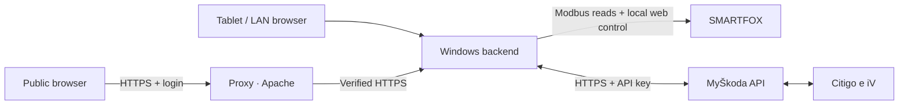
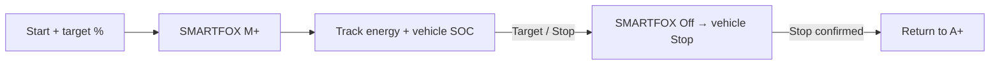

# CitiFoxCharger · 1.10.9

A Windows tablet dashboard for a **Škoda Citigo e iV** and **SMARTFOX Pro 2 / Charger Pro**. Charging targets, home energy and heating controls in one German/English interface.

## Connections

## Charging

Targets use an energy-based SOC estimate corrected by vehicle reports. **An exact battery limit is not guaranteed.** The backend must keep running; the display may turn off.

## Start

1. Install **Python 3.11+** and download/clone this repository.
2. Run **Start.cmd** to open Brave full screen at **http://localhost:8765/**.
3. Add the VIN/API key in Settings, save with Windows encryption, then choose a target and **Start charging**.

Private-LAN HTTPS can be passwordless. Public access requires the configured password-protected gateway; public administration and updates are blocked.

## Details

- [Windows/tablet setup and scripts](TABLET.md) · [Network, certificates and gateway](NETWORK.md)
- [Charging logic and limitations](MANUAL-CHARGING.md) · [Interfaces and compatibility](INTERFACES.md)
- [Registers, API calls and diagrams](COMMUNICATION.md) · [Test results](TEST-REPORT.md)
